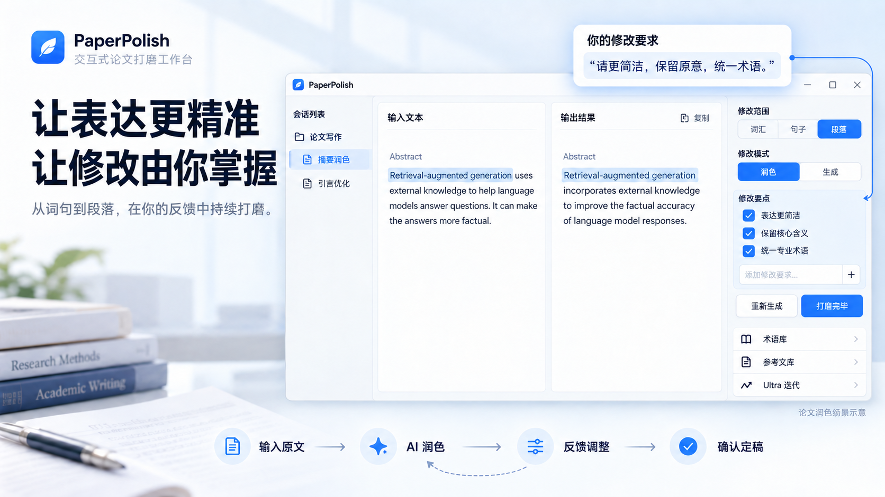

# PaperPolish

[中文说明](README.zh.md) · [v0.1.0 release notes](docs/releases/v0.1.0.md) · [Build and publish](docs/RELEASING.md)

[Download for Windows](https://github.com/Ytang520/paper-polish_interactive_product/releases/tag/v0.1.0)

PaperPolish is an all-in-one desktop application for paper polishing. It is designed to bring structured writing workflows, model orchestration, and iterative refinement into a single workspace for academic and professional writing.

## Overview

PaperPolish is being built toward a long-term vision:

- an all-in-one paper polishing platform
- support for multiple operating systems
- a built-in agent system
- natural-language driven customization, so users can eventually modify components, layouts, and lightweight features with a single instruction

In short, the goal is not only to polish text well, but to become a flexible writing workbench that can adapt to many real-world scenarios.

## Workflow

The current end-to-end workflow is:

1. Create a new session
2. Paste or write your source text in the input editor
3. Configure scope, mode, model, output language, and supporting options
4. Click `Start Polish` to launch the current round
5. If needed, click `Force Stop` to interrupt the active generation while preserving the partial output
6. Review the result, extracted key points, terminology, references, and optional Ultra iterations
7. Click `Finish Polish` or use `Ctrl+Enter` to move into the next polishing session
8. Use `Regenerate` when you want a new result from the same input and configuration

The app also includes an in-app Help view with a `workflow` section that explains this process visually.

## Current Features

PaperPolish currently supports:

- multi-session paper polishing with session history and folder organization
- word-level, sentence-level, and paragraph-level polishing workflows
- refinement mode and paragraph generation mode
- key point extraction and structured follow-up requirements
- terminology support, including professional terminology and document-level terminology
- reference article management with embedding-based retrieval support
- Ultra mode for generator-evaluator iterative refinement
- per-module model configuration, output language settings, and custom prompts
- persistent settings, sessions, and folders across app restarts
- GitHub Copilot local provider integration, alongside standard OpenAI-compatible providers
- a built-in Help workflow view for onboarding and product guidance

## Quick Start

### Option 1: Use the built-in providers directly

1. Launch the app
2. Open Settings and configure your provider URL, API key, and model; default keys are empty
3. Create a session and paste your text into the input panel
4. Choose the appropriate scope, mode, model, and options
5. Start polishing

### Option 2: Use a Copilot reverse proxy (optional)

If you want to use the GitHub Copilot-based local provider, you may set up a Copilot reverse proxy first.

- Reference: https://github.com/ericc-ch/copilot-api

After that, just launch the app and use it normally.

## Configuration and File Locations

### Settings, API keys, and base URLs

Persistent runtime settings are stored in Electron's user-data directory as `config.json`.

On Windows, the path is typically:

`%APPDATA%/paper-polish/config.json`

This file contains:

- module-level `base_url`
- module-level `api_key`
- model parameters
- custom prompt overrides
- UI-related persistent settings

For the managed GitHub Copilot provider, the app uses:

- fixed base URL: `http://localhost:8070/v1`
- local token file: `%USERPROFILE%/.local/share/copilot-api/github_token`

### Prompt locations

Default built-in prompts are defined in:

- `src/renderer/src/prompts/index.ts`

More specifically:

- all default workflow prompts live under the `DEFAULT_PROMPTS` object in `src/renderer/src/prompts/index.ts`
- the prompt resolution function is `getPrompt(...)` in `src/renderer/src/prompts/index.ts`
- user-edited custom prompts are configured through `src/renderer/src/components/SettingsModal.tsx`
- customized prompt values are persisted in `config.json` under the `customPrompts` field

## Roadmap

### User Experience

- broader support across different operating systems
- integrated video introduction and tutorial materials
- a cleaner, more elegant, and more intuitive product experience

### Product Capabilities

- visual and customizable paper polishing workflows, in the spirit of Dify
- one-sentence user-driven platform customization, including layout changes and lightweight feature extensions

### Model Layer

- a dedicated paper polishing LLM
- a specialized feature-development agent designed specifically for this application

## Built With

PaperPolish is built as an Electron desktop app with a modern TypeScript and React-based interface, persistent local storage, configurable OpenAI-compatible model backends, and workflow-oriented writing utilities.

## Acknowledgment

This app was developed with the help of [OpenCode](https://github.com/anomalyco/opencode), especially [OMO](https://github.com/code-yeongyu/oh-my-openagent).

Special thanks to them.
